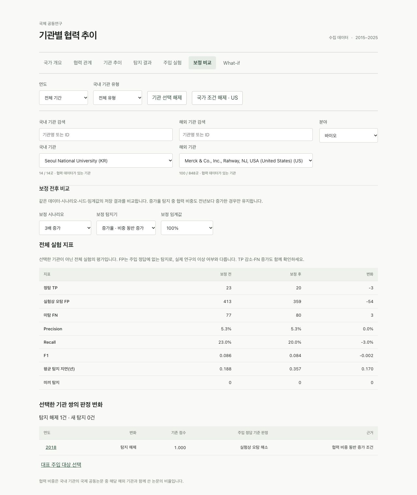
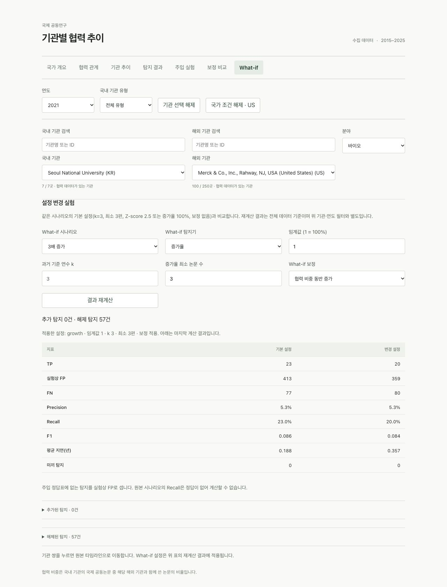

# 분석 화면·What-if 통합 기록

## 반영한 팀 작업

최신 main `4b911a6`에서 `feat/analysis-views`를 만들었습니다. 확인 시 PR #1~#13은 모두 병합됐으며 열린 PR은 없었습니다. 직전 프론트 PR #10 이후 다음 변경을 반영했습니다.

- [#11 개요·평가 API](https://github.com/Web-base-system-project-1/webbasesystem_project1/pull/11): 국가·분야·연도 집계와 저장 평가 조회.
- [#12 데이터 v2](https://github.com/Web-base-system-project-1/webbasesystem_project1/pull/12): 고유 논문·국가 집계, 보정 전후 84회 결과, 원자료 검증.
- [#13 평가 보고서](https://github.com/Web-base-system-project-1/webbasesystem_project1/pull/13): 실험·보정 효과와 한계.

화면과 실험은 기본 v2 ZIP을 사용합니다. 데이터 버전은 `openalex-four-fields-2015-2025-1c38caf53194`입니다. 기존 `.env`에 과거 DATA_DIR이 있으면 비우고 Flask를 재시작합니다. 데이터는 분야마다 선정한 하위 토픽 범위이며 전체 분야 통계가 아닙니다.

## 구현 범위

| 화면 | 동작 및 범위 |
|---|---|
| 국가 개요 | 국가×연도 협력 비중/탐지 건수. 고유 논문·국가 집계이며 기관 쌍 합과 구분. 전국 개요로 분야·연도만 적용 |
| 협력 관계 | 국내·해외 각각 상위 15곳 행렬, 양수 공동논문 수·탐지 표시, 전체/표시 관계 수 안내 |
| 기관 추이 | 건수·비중·직전 3년 평균·표준편차·탐지 및 연도별 근거. 전체 기간을 유지하고 선택 연도 강조 |
| 탐지 결과 | 분야·기관·연도·국내 유형 범위의 원본 탐지, 정렬·방법/일치 조건·페이지 이동, 클릭 연동 |
| 주입 실험 | 원본·2/3/5배·점진·급증·미끼 7개 시나리오, 원본/주입 차트·근거·전체 지표 |
| 보정 비교 | 증가율 비중 동반 증가, Z-score 국내 총수 최소 3편. 전후 지표·판정 변화·주입 정답 기준 오류 구분 |
| What-if | 시나리오·탐지기·임계값·k·최소 건수·보정을 적용해 재계산. 기본 설정 대비 지표와 추가/해제 탐지 |

기관 검색에도 분야·연도·국내 유형·상대 기관 조건을 적용합니다. 유형을 바꾸면 기관 선택을 비웁니다. 국가 셀 → 국가 내 기관 행렬 → 기관 쌍 타임라인으로 이동합니다. 탐지·보정·What-if 사례 클릭도 원본 타임라인과 강조 연도를 바꿉니다.

What-if와 보정의 전체 평가를 기관별 수치로 표시하지 않습니다. What-if 비교 기준은 **같은 시나리오**의 기본 탐지 설정(k=3, 최소 3편, Z-score 2.5/증가율 100%, 보정 없음)입니다. 입력 패널은 변경 상세를 기본 20건까지 표시하고 전체 건수를 따로 안내합니다.

API는 기존 계산 함수를 재사용합니다. `/api/matrix`, `POST /api/whatif`를 추가하고 `/api/experiment-timeline`에 correction_id와 보정 전 지표·탐지를 추가했습니다. PR #15~#17과 통합하여 `/api/comparison`, `/api/comparison/changes`를 함께 제공합니다. What-if API는 한 경로로 통합하고 #17의 입력 패널을 실제 화면에 연결했습니다. 캐시는 데이터 버전·시나리오·탐지기·설정·보정별로 DataStore마다 8개를 보관하며 동시 요청과 데이터 재로드를 처리합니다.

## 검증

- Python 전체 검사: **169개 통과**. 신규 16개는 원본 집계와 행렬/기관 검색을 대조하고, 두 보정의 저장 지표·What-if 재계산·잘못된 입력을 검증합니다.
- 프론트 기존 검사 10개 통과, lint·프로덕션 빌드 통과.
- 브라우저에서 국가 개요 → 기관 관계 → 타임라인, 보정 지표와 판정 변화, What-if 재계산을 확인했습니다. 390px 화면의 문서 너비가 390px로 유지되는 것도 확인했습니다. 전체 접근성·모든 기기 검증을 완료한 것은 아닙니다.
- 바이오·2021·US 비중 **94/110=85.5%** 표시와 국가 행렬 이동을 확인했습니다.
- step_x3·증가율 100%·비중 동반 증가 보정: **TP 23→20, FP 413→359, FN 77→80, F1 0.086→0.084**, 추가 0/해제 57건. 저장 CSV와 재계산·화면이 일치합니다. 오탐 감소만으로 개선됐다고 판단하지 않습니다.
- API 요청 취소·버전 확인, 로딩·빈 결과·조회 실패/재시도 안내를 구현했습니다. 실패 상태의 새 화면별 수동 재현은 아래 최종 검증에서 추가 확인합니다.

실행 명령은 [프론트 안내](../frontend/README.md), 전체 설치는 [Mac·Windows 안내](running.md), 응답은 [API 명세](api.md)를 참고합니다. 화면 실행에 추가 패키지는 필요 없습니다.

## 화면 기록

## 남은 팀 검증·제출 작업

1. 다른 팀원 한 명과 별도 도구가 변경을 검토하고 팀 시연을 확인합니다.
2. 새 설치 및 다른 팀원 PC·실제 Windows 실행, 데이터 재생성을 확인합니다.
3. 빈 결과·결측·서버 실패·버전 교체의 모든 화면과 필터 조합을 점검합니다. 현재 원본 탐지 목록은 최대 1000행을 로드하며 초과 시 표시 수를 안내합니다.
4. 최종 데이터 버전의 화면·보고서·발표 수치를 맞추고 시연 자료·예비 영상을 만듭니다.
5. 최종 실행 방식과 제출 파일을 확정합니다. Vite 개발 프록시 실행만으로 최종 배포가 완료된 것은 아닙니다.

이번 범위는 일정의 기본 분석 화면과 What-if·보정 비교 구현입니다. 위 공동 검증과 제출 준비까지 완료했다고 체크하지 않습니다.

## 2026-11-24 PR #14~#17 통합 검증

- What-if 경로 중복을 제거하고 #16 계산·캐시와 #17 입력 패널을 실제 분석 화면에 연결했습니다. 기본·사용자 지정 비교 기준과 기존 분석 응답 별칭을 함께 지원합니다.
- 잘못된 JSON·객체·소수 정수·과대 숫자 입력을 400으로 처리하고, 캐시를 DataStore마다 분리해 재로드 및 동시 요청을 보호했습니다. 보정 비교의 상세·요약 필터를 맞추고 k·min_count 조건을 추가했습니다.
- Python 188개, 프론트 13개 검사 및 lint·프로덕션 빌드를 통과했습니다. 저장된 84회 실험의 TP·FP·FN·미끼 오탐과 What-if 재계산이 모두 일치하며, 42개 보정 비교의 판정 변화 수도 평가 차이와 일치합니다.
- 브라우저에서 국가 셀 → 기관 행렬 → 원본 타임라인, What-if 계산 및 사례 → 강조 연도 이동, 두 탐지기의 보정 비교를 확인했습니다. 증가율 step_x3의 탐지 436→379건(57건 해제), TP 23→20, FP 413→359가 저장 평가와 일치했습니다. 브라우저 오류 로그는 없었습니다.
- 입력 패널은 응답 버전을 확인하고 취소·이전 요청을 무시하며, 표에 마지막으로 적용한 설정을 표시합니다. 이 검증은 다른 팀원 PC 및 실제 Windows 실행·최종 제출 검증을 대신하지 않습니다.
